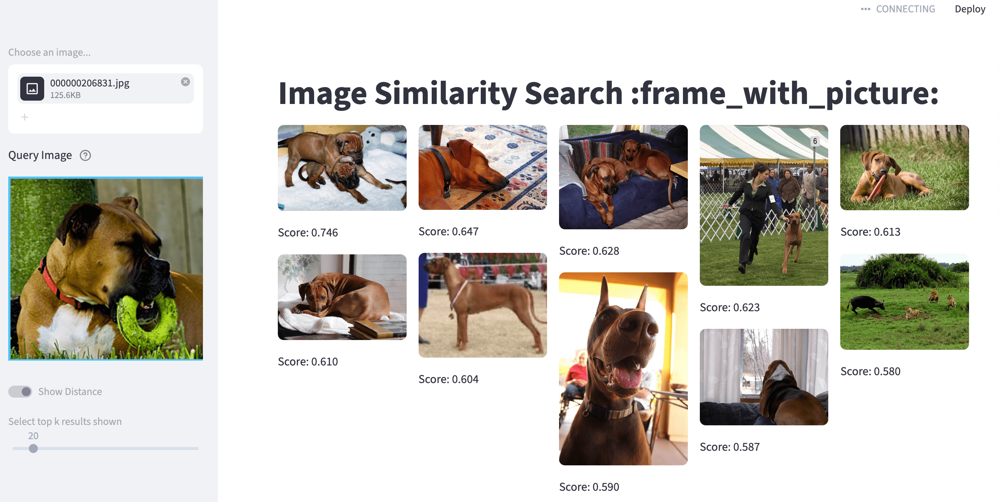
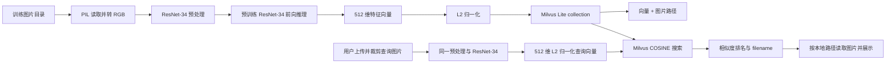

# milvus-learn
此项目是测试milvus向量数据库，用图搜索图

参考官方示例：https://github.com/milvus-io/bootcamp/blob/master/tutorials/quickstart/apps/image_search_with_milvus

使用timm的ResNet-34模型从图像中提取嵌入信息；

图片向量度量方式：余弦距离(COSINE)；

## 需要组件
milvus-lite：本地向量数据库，项目依赖加载时就会安装(即服务逻辑都在python包中)；

## 操作步骤
具体步骤可参考：https://github.com/milvus-io/bootcamp/blob/master/tutorials/quickstart/apps/image_search_with_milvus/README.md

0环境配置
.env.example改为.env即可，或按实际配置来修改；
主要就是本地向量数据库存储地址，使用的模型等参数配置；

1把图片数据集导入milvus向量数据库
~~~
python insert.py ./milvus-data/reverse_image_search/train
~~~
>数据集来源：https://github.com/milvus-io/pymilvus-assets/releases/download/imagedata/reverse_image_search.zip

2启动python app对外服务
~~~
streamlit run app.py
~~~
这时候可以打开：http://localhost:8501/ ；

3搜索图片
打开：http://localhost:8501/ ；上传图片进行搜索

上传待搜索图片，就能看到相关图片，以及图片距离分数(分数越大，图片相似度越高)

效果图：

## 目录介绍
milvus-data/milvus_demo.db即milvus-lite本地向量数据库；

milvus-data/reverse_image_search，图片数据集，来自https://github.com/milvus-io/pymilvus-assets/releases/download/imagedata/reverse_image_search.zip
> 注意：milvus-data目录不上传git，附件下载后，放到此目录下即可；

## 原理

