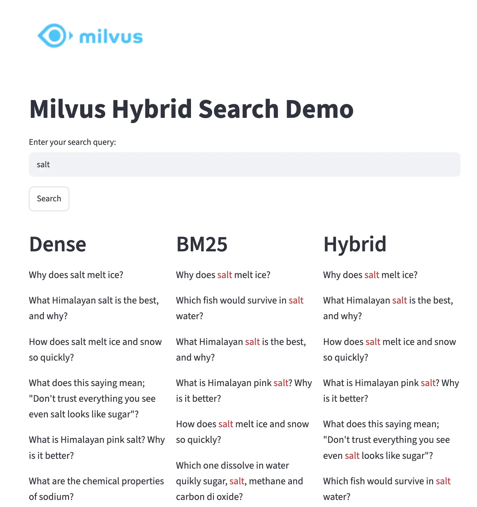

# milvus-text-search-learn
此项目是测试milvus向量数据库混合搜索功能

sparse稀疏向量(关键字)匹配、dense稠密向量(语义)匹配

参考官方示例：https://github.com/milvus-io/bootcamp/blob/master/tutorials/quickstart/apps/hybrid_demo_with_milvus/README.md，

本demo进行了一些改造；milvus-lite本地数据库不支持bm25算法，直接在项目中手动计算bm25；dense也使用轻量级模型all-MiniLM-L6-v2来跑；

## 需要组件
milvus-lite：本地向量数据库，项目依赖加载时就会安装(即服务逻辑都在python包中)；

## 技术说明
每条文本会同时存储两种向量：
1. MiniLM 生成的 dense 向量，用于语义相似度搜索；
2. 本地代码计算的BM25 sparse向量，用于关键词相关性搜索。
> sparse生成：这里没有调用 Milvus 内置 BM25 Function，而是在 Python 进程中计算 BM25 所需的
词项权重，并将结果编码成 Milvus 可检索的稀疏向量。这样可以在不支持内置 BM25
全文搜索的 Milvus Lite 环境中，仍然把 BM25 作为一条独立的 sparse 检索通道
> 
> dense生成：使用SentenceTransformer框架all-MiniLM-L6-v2模型，生成384维的向量；

Milvus的hybrid_search会分别执行两条检索，再由ranker融合结果。

## 流程
* 1 下载语料库
* 2 insert.py把预料数据集；
    - 使用bm25算法生成sparse向量，并保存bm25词表、相应元数据(IDF 数组、avgdl平均文档长度和文档数)到pkl文件中，供后续搜索使用；
    - 使用使用SentenceTransformer框架all-MiniLM-L6-v2模型，生成384维dense向量；

    把生成的sparse、dense向量存入milvus库
* 3 利用milvus sdk能力，进行搜索；如果是sparse、dense混合搜索，则再根据这两路搜索结果进行reranking排序后，返回结果；对应入口：ui.py

## 操作步骤

0同步项目依赖
~~~
uv sync
~~~

1把文本数据集导入milvus向量数据库
~~~
python insert.py 
~~~
最终数据存储在生成parquet格式文件中，还包括索引idx、元数据等文件；
> 小型语料库数据集来源：http://qim.fs.quoracdn.net/quora_duplicate_questions.tsv
> 下载后存放在数据文件:milvus-data/milvus-data/quora_duplicate_questions.tsv

2启动python app对外服务
~~~
streamlit run ui.py
~~~
这时候可以打开：http://localhost:8501/ ；

3搜索
打开：http://localhost:8501/ ；输入文本搜索
> 搜索流程概述：bm25，sparse向量精确匹配；dense向量进行ip计算，得到相似度结果；混合搜索：同时进行sparse、dense双通道搜索，根据预设权重，rerank排序后返回结果；

效果图：

## 目录介绍
milvus-data：此demo数据存储目录，此目录不上传git，通过操作步骤会自动生成对应的文件；

本地向量数据库：milvus-data/milvus_demo.db即milvus-lite；

文本数据集：milvus-data/quora_duplicate_questions.tsv，来自https://github.com/milvus-io/pymilvus-assets/releases/download/imagedata/reverse_image_search.zip

bm25生成的元数据：milvus-data/bm25_state.pkl，保存sklearn vectorizer、IDF 数组、avgdl平均文档长度和文档数量

insert.py：把文本数据集生成sparse、dense向量，存入milvus向量数据库；

ui.py：对外提供文本搜索服务

